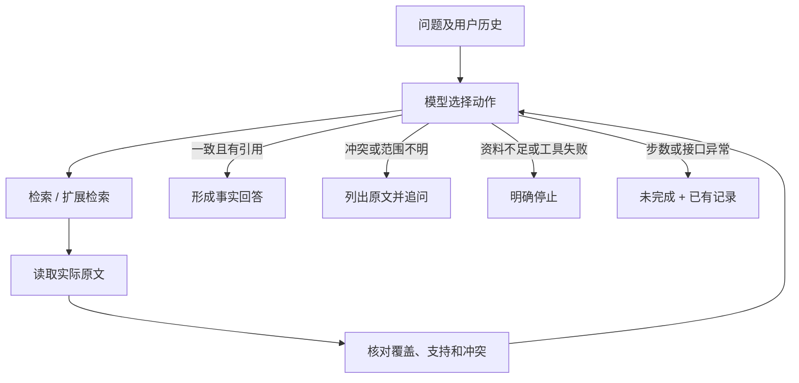

# 流程、动态决策与工程取舍

## 模型循环

`agent.py`只分发模型返回的动作、回传实际观察并判断结束，不包含“遇到30/15就追问”的业务决策分支。模型原生tool_calls支持多轮；预设工具与句式限制是执行骨架，不是伪造决策日志。

## 工具职责

| 工具 | 职责 |
|---|---|
| inspect_question | 问题、用户历史线索、候选主题和是否需澄清 |
| search_documents | 词法检索；keyword/expanded策略、文档日期、片段索引 |
| read_snippet | 读取实际原文、内容指纹与可核验事实 |
| check_evidence | 核对相关来源覆盖、所问事实、适用范围与冲突 |
| answer_question | 使用已核验source_id输出与原文一致的事实回答 |
| request_clarification | 有依据地请求主题、制度或范围确认 |
| stop | 资料不足或工具失败时保留来源并停止 |

Trace由执行时自动生成；`next_action`在下一轮模型真实返回后记录，`decision_basis`为一句事实依据，不保存内部思维过程。

## 检索与上下文

词法检索以报销、期限、材料、年假、导出、分辨率等术语匹配原文与标题。首次查询无结果时，模型可选择expanded或改写query，工具将问题主题映射到制度术语。该方案依赖有限术语表，不声称有向量语义检索能力。

上下文解析只从先前用户问题推断主题；助手历史中“999天”等说法不进入证据账本。多主题或缺少明确主题时追问，不把一个问题的答案套给另一个问题。

## 引用与防遗漏

检索摘要只用于发现文档，不产生回答权限。read_snippet建立带doc_id、chunk_id、版本日期、原文和SHA-256指纹的来源账本。事实从原文的受支持肯定句式抽取，而非硬编码文档ID到答案。

check_evidence使用可信主题索引检查所有相关启用来源是否读全；还有D02未读时，即使D01支持30天，也不能宣称无冲突。相关文档无法抽取明确事实时，不得忽略它后仅引用其他来源给出唯一答案。

answer_question只接受claim_key和已读source_id，不接受任意答案文字或模型新增的适用文档。原文中所问事实、引用主题、来源ID都须匹配；由核验后的值生成回答模板，防止额外未获支持的主张。这是闭集事实核验方案，不是任意文本语义蕴含判断。

## 冲突和适用关系

30与15在没有范围/优先关系时属于未决冲突。版本日期只展示，不单独形成优先级。用户通过可信输入applicable_doc_id或scope确认后，按相应来源核验；模型参数不能自行修改这些字段。

示例支持原文明确的“本条款明确替代D01”句式；替代关系只应用于该条款抽取出的同一事实，相关原文仍作为引用。循环替代返回冲突。该规则只是受限合成语法，复杂真实制度的废止、适用时间和层级仍需更完整的规则模型。

## 技术与运行

Python3.11标准库实现CLI、urllib客户端、检索和HTTP页面，无Agent框架或第三方运行依赖。DeepSeek原生协议依据2026-10-31查看的 [Tool Calls](https://api-docs.deepseek.com/guides/tool_calls/) 与 [Chat Completions](https://api-docs.deepseek.com/api/create-chat-completion/) 官方文档：关闭thinking，tool_choice=required，每轮仅接受一个工具调用。

默认24步、每次45秒、输出1024 tokens、最多1MB响应。接口错误明确未完成，不暗中回退Mock。知识库每次任务加载为固定快照，下次任务重新读取文件，避免引用与回答跨版本混用。

网页使用127.0.0.1本地HTTP服务，限制Host/Origin和静态路径，输入通过textContent呈现；页面调用同一核心。CLI和网页结果包含完整Trace，网页历史保留当时原文快照；没有云端发布或企业权限系统。
