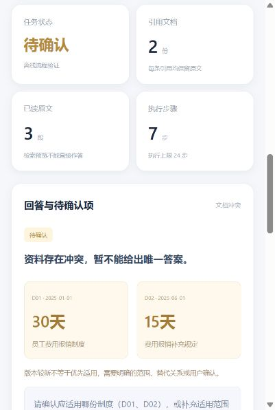
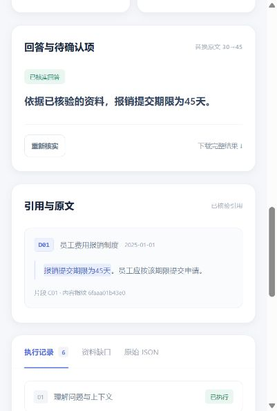

# 本机浏览器实际验证

日期：2026-10-31。启动 `python scripts/web.py --port 8766`，在浏览器打开本机服务。以下是实际点击观察，不是预设模型决策日志；运行模式为离线Mock。

| 操作 | 实际结果 |
|---|---|
| 默认文档冲突并提问 | 状态待确认，D01=30天、D02=15天，显示两份版本和原文，不给唯一答案 |
| 点击确认采用D01 | 适用制度字段变为D01，回答30天且只引用D01 |
| 接着输入“那需要哪些材料？” | 结合实际用户历史定位报销材料，引用D01-C02的电子发票和审批记录 |
| 点击替换原文并提问 | 回答45天，原文与内容指纹同步更新 |
| 点击改写问题并提问 | 报账措辞首次无结果，第二次expanded检索“报销 期限”，随后读原文回答 |
| 展开第二次检索 | 参数、实际命中和后续读取动作可见 |
| 点击工具失败并提问 | D02读取失败，保留D01作为已读来源，状态失败，不把30天宣布为唯一答案 |
| 点击资料外问题并提问 | 资料不足，无引用；经过两次检索后停止 |
| 下载完整结果 | 浏览器实际下载JSON，包含答案、原文引用与完整Trace |

HTTP及核心测试共59项通过；20个离线验收场景通过。截图仅补充界面证据，不替代源代码、输入输出和Trace。

原生JS语法检查通过，标准wheel构建成功，包内包含网页HTML/CSS/JS资源。没有运行真实DeepSeek或评估真实提示注入稳定性。
